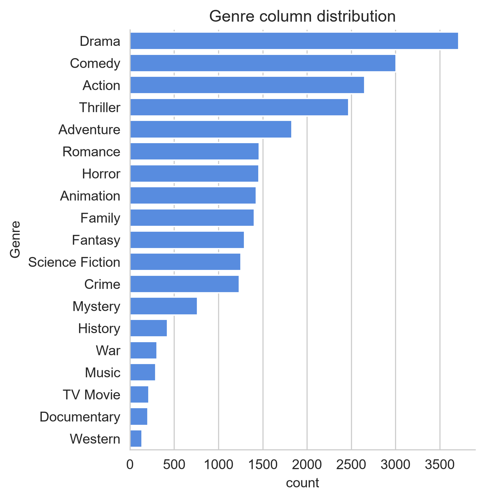
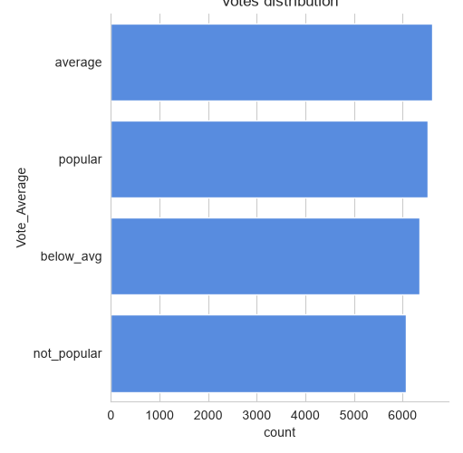
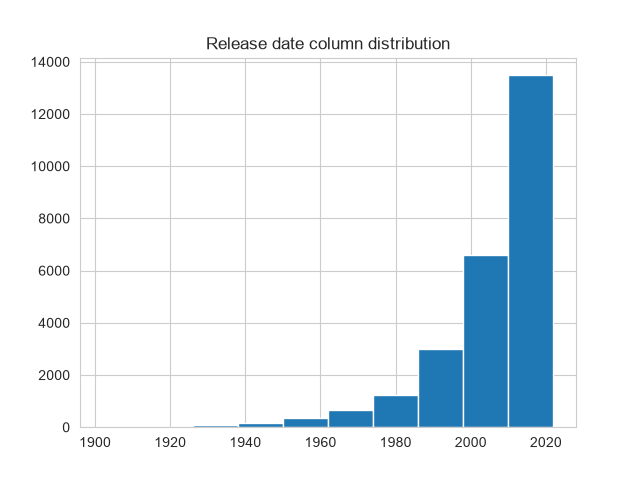
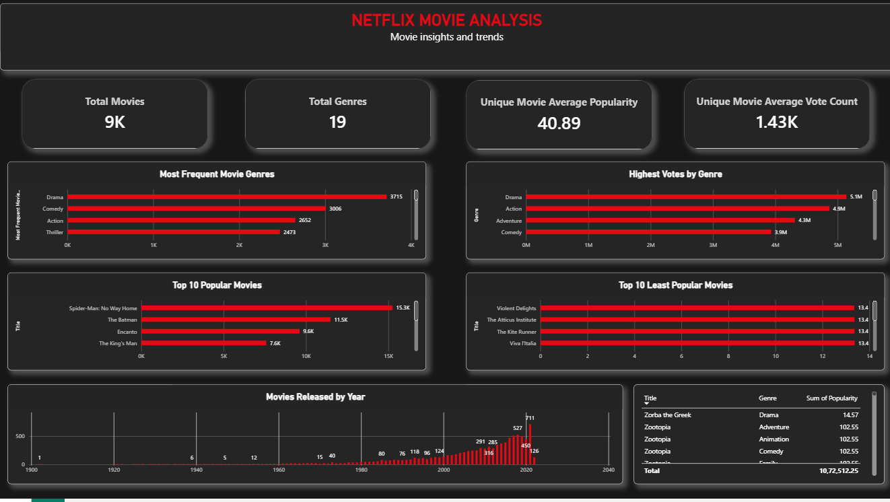

# Netflix Movie Data Analysis

## Project Overview

This project focuses on analysing a Netflix movie dataset using Python and Power BI. The objective is to explore movie genres, popularity, audience votes, and yearly release trends to discover meaningful insights from the data.

The project includes data cleaning, Exploratory Data Analysis (EDA), data visualisation, and Power BI dashboard development.

## Tools & Technologies

- Python
- Pandas
- NumPy
- Matplotlib
- Seaborn
- Jupyter Notebook
- Power BI

## Project Workflow

1. **Data Cleaning:** Inspected and prepared the dataset for analysis.
2. **Exploratory Data Analysis:** Explored movie genres, popularity, vote counts, and release years using Python.
3. **Data Visualisation:** Created charts using Matplotlib and Seaborn.
4. **Dashboard Development:** Built a Power BI dashboard to present key findings and insights.

## Business Questions & Key Insights

### 1. Which movie genre appears most frequently?
**Answer:** Drama.

### 2. Which genres have the highest number of votes?
**Answer:** Drama has the highest total vote count in the genre analysis.

### 3. Which movie has the highest popularity, and what is its genre?
**Answer:** Spider-Man: No Way Home.

### 4. Which movie has the lowest popularity, and what is its genre?
**Answer:** Violent Delights – Horror.

### 5. Which year had the highest number of movies released?
**Answer:** 2021, with 711 distinct movies.

## Python Data Visualisations

The following charts were created during Exploratory Data Analysis using Python.

### Genre Distribution

### Average Votes

### Yearly Movie Releases

## Power BI Dashboard

An interactive Power BI dashboard was developed to present the analysis through KPI cards and visualisations.

### Dashboard Preview

### Dashboard Highlights

- Total Movies
- Total Genres
- Average Popularity
- Average Vote Count
- Most Frequent Movie Genres
- Genres with Highest Total Votes
- Top 10 Most Popular Movies
- Top 10 Least Popular Movies
- Movies Released by Year
- Most Popular Movie Details

## Conclusion

This project provided practical experience in data cleaning, exploratory data analysis, data visualisation, and dashboard development.

Using Python and Power BI, I explored movie genre distribution, popularity patterns, voting trends, and yearly movie releases.

It helped strengthen my analytical thinking and ability to present data-driven insights through visualisations and dashboards.